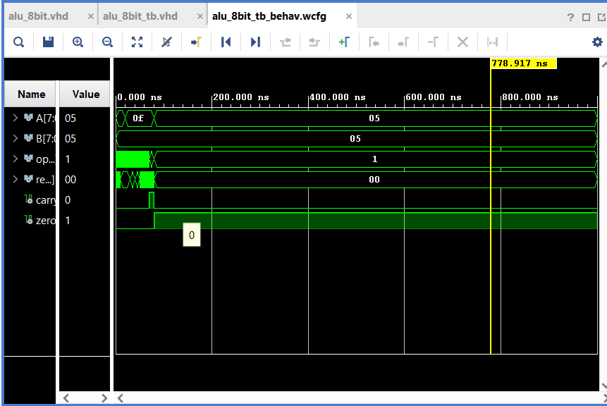

 8-Bit ALU Design Using VHDL


 Project Overview


This project implements an 8-bit Arithmetic Logic Unit (ALU) using VHDL in AMD Xilinx Vivado 2024.1.


The ALU performs arithmetic, logical, and shift operations based on a 3-bit opcode. The design includes carry and zero status flags.


 Features


~ 8-bit input operands (A and B)

~ 3-bit operation selector (opcode)

~ 8-bit result output

~ Carry/borrow flag

~ Zero flag

~ VHDL-based RTL implementation

~ Self-checking VHDL testbench


 Supported Operations


| Opcode | Operation | Description |

|---|---|---|

| 000 | ADD | A + B |

| 001 | SUB | A - B |

| 010 | AND | Bitwise AND |

| 011 | OR | Bitwise OR |

| 100 | XOR | Bitwise XOR |

| 101 | NOT | Bitwise NOT of A |

| 110 | Shift Left | Logical left shift of A |

| 111 | Shift Right | Logical right shift of A |


 Design Inputs and Outputs


*Inputs*

\- `A`: 8-bit input operand

\- `B`: 8-bit input operand

\- `opcode`: 3-bit operation selector


\*\*Outputs\*\*

\- `result`: 8-bit ALU output

\- `carry`: Carry or borrow indicator, depending on the operation

\- `zero`: Asserted when the result is zero


 Project Structure


```text

ALU\_8bit/

├── ALU\_8bit.xpr

├── ALU\_8bit.srcs/

│   ├── sources\_1/

│   │   └── new/

│   │       └── alu\_8bit.vhd

│   └── sim\_1/

│       └── new/

│           └── alu\_8bit\_tb.vhd

├── alu\_8bit\_tb\_behav.wcfg

└── README.md

```


 Verification


A self-checking VHDL testbench was developed to verify all eight ALU operations.


The testbench checks:

\- Addition: 10 + 5 = 15

\- Subtraction: 10 - 5 = 5

\- AND, OR, and XOR operations

\- NOT operation

\- Logical left and right shifts

\- Zero flag functionality


\*\*Simulation result:\*\* All ALU tests completed successfully in Vivado XSim.
The following waveform shows the functional verification of all eight ALU operations.




 Tools and Technologies


\- VHDL

\- AMD Xilinx Vivado 2024.1

\- XSim Simulator

\- RTL Design and Functional Verification


 Learning Outcomes


\- RTL design using VHDL

\- Arithmetic and logical circuit implementation

\- Opcode-based operation selection

\- Testbench development and assertion-based verification

\- Functional simulation and waveform analysis


 Author


PADMA SHREE KONDRAHALLI BYRA REDDY
Master's Student – Information and Electrical Engineering  

Hochschule Wismar, Germany


